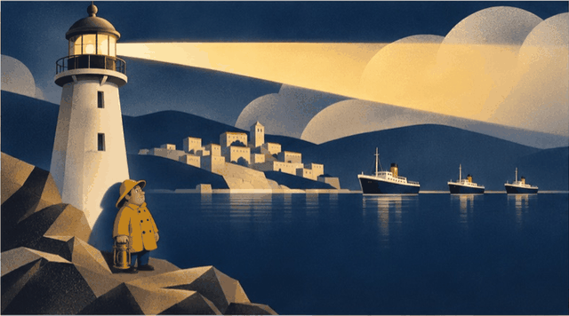
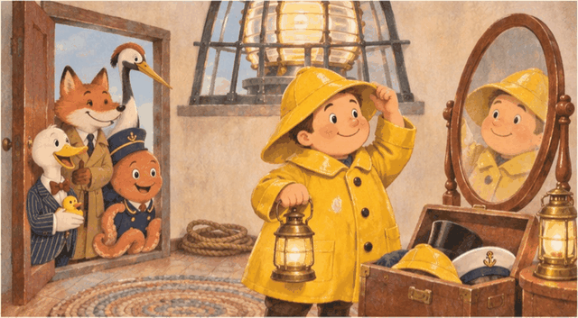
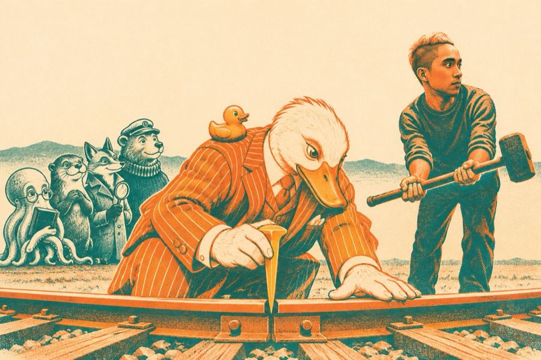
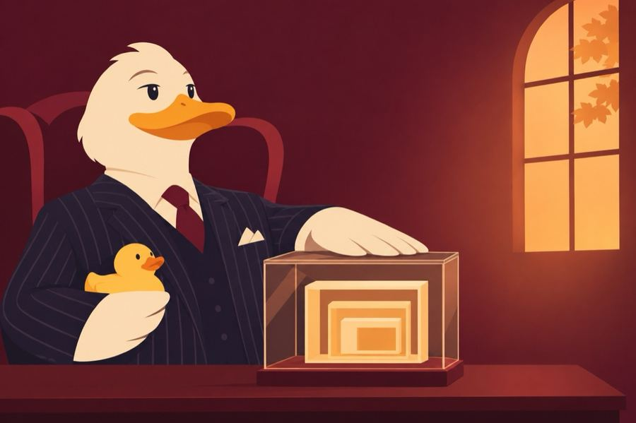
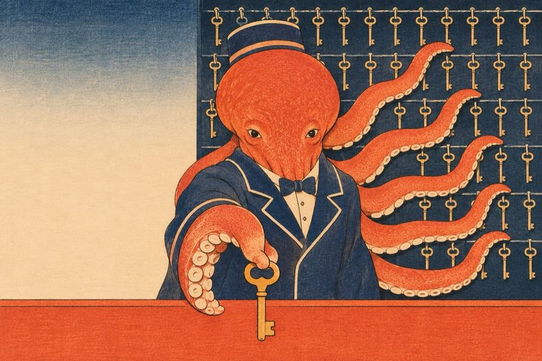
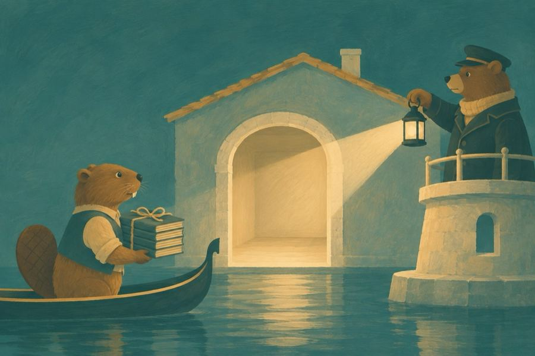
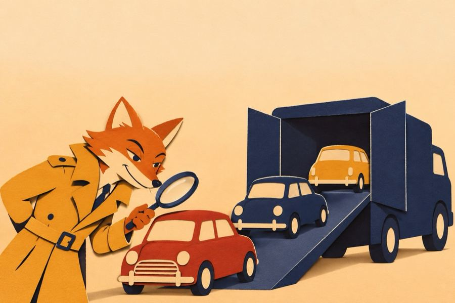
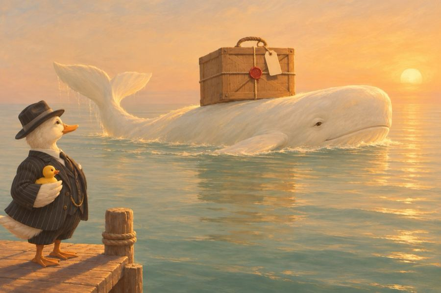
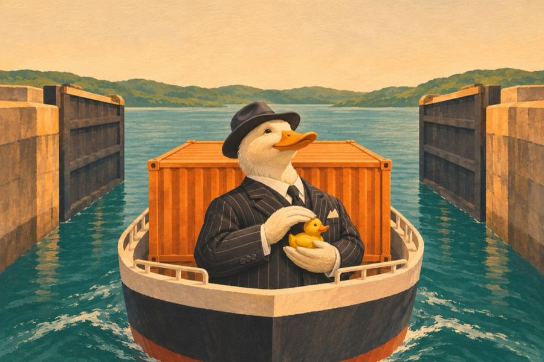

Code review is work nobody sees, so PR Spotlight comments on every merged PR with a picture of the people behind it and a short lesson from its diff, and the reviewers are the stars. Each picture takes a new art style and a story from the diff; everyone is an animal until they say yes to their own face. See the [deck](https://ngnnah.github.io/I-And-AI/projects/pr-spotlight/), or clone the [code](https://github.com/ngnnah/pr-spotlight) for your team.

  
  
  
  
  
  
  
  
  
  
  
  
  

