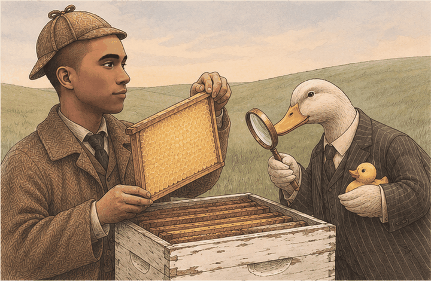

Code review is work nobody sees. A reviewer reads someone else's diff, catches the bug before it reaches prod, and the PR merges under the author's name.

With PR Spotlight, every merged PR gets a comment with a picture of the people behind it and a short lesson from its diff: what it shipped, a thanks to the reviewer, a lesson and a tip. On a release, the reviewers are the stars.

The story in each picture comes from the diff: DuckDB turns into a duck godfather, and a big release into the golden spike of the first transcontinental railroad. The style changes every time. I built up 261 art styles, and the least-used one goes next, so a routine review gets a sprinkle of fun. Some spotlights are short looping GIFs.

Everyone starts as an animal totem. A teammate is drawn from their own photos only after they say yes.

It runs every 15 minutes on my Mac. Claude writes the idea and the caption, and the Codex CLI on my ChatGPT plan draws the picture, so there's no API key.

- The picture-book deck: [PR Spotlight](https://ngnnah.github.io/I-And-AI/projects/pr-spotlight/).
- The code, MIT licensed, to clone for your team: [ngnnah/pr-spotlight](https://github.com/ngnnah/pr-spotlight). Its README has one prompt to paste into Claude Code.
